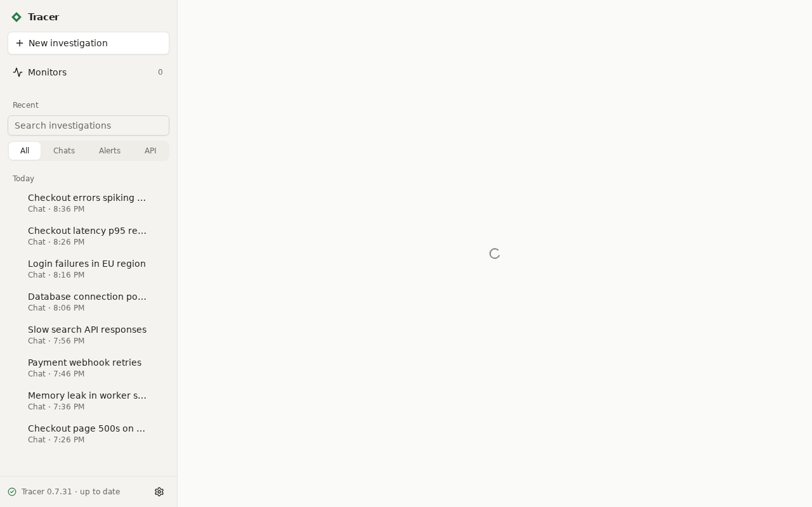
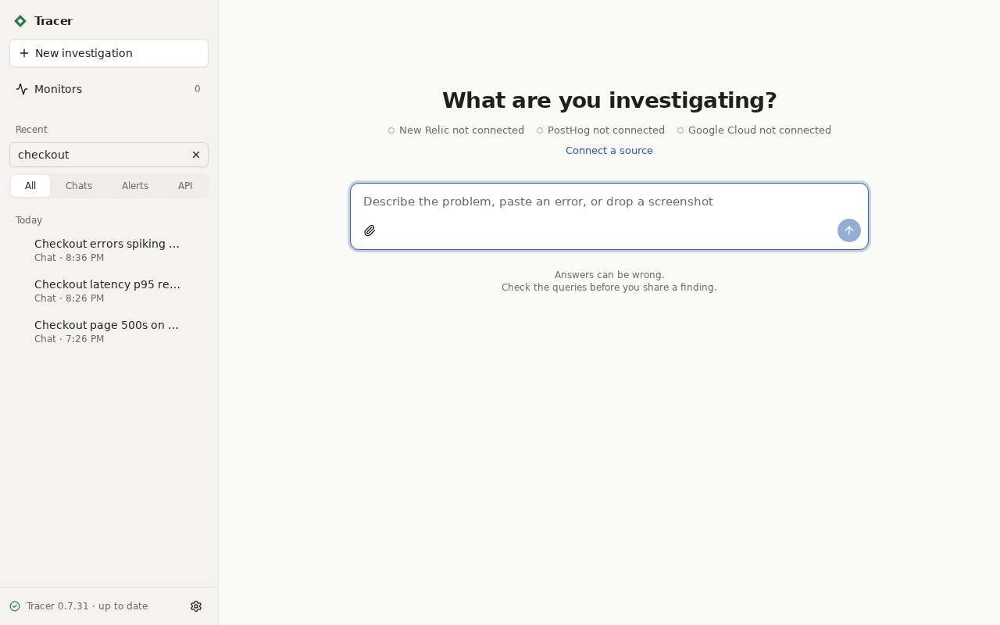
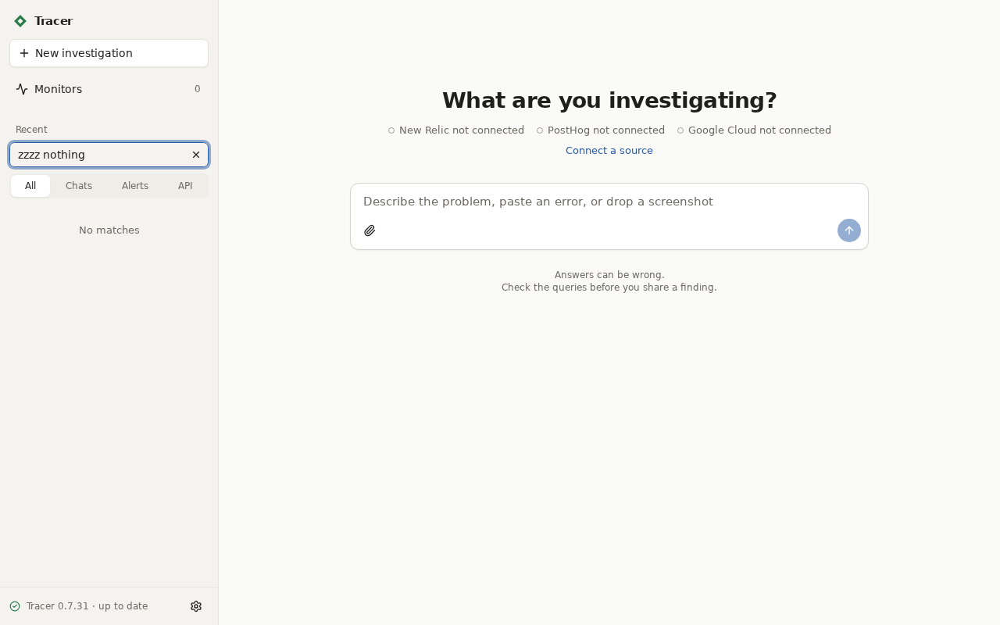

# Add title search to the sidebar Recent list

## What changed

- The sidebar's Recent list has a "Search investigations" box above the All/Chats/Alerts/API filter. Typing narrows the list to sessions whose title contains every typed word (case-insensitive, any order, extra whitespace ignored). It combines with the kind filter. A clear button (x) resets it. When nothing matches, the list shows "No matches" instead of "Nothing here yet".
- New pure helper `packages/web/src/lib/session-search.ts` exporting `matchesQuery(title, query)`, with unit tests in `packages/web/src/lib/session-search.test.ts` (5 tests: empty/blank query, case, word order, whitespace, no match).
- `packages/web/src/components/layout/RecentSessions.tsx` holds the query state, renders the input and clear button, filters inside the existing `useMemo`, and resets the row limit when the query changes.
- `PLAN.md` records the review and plan for this change.
- Three screenshots are added under `docs/screenshots/`.

## Why

The Recent list grows without bound and could only be filtered by session kind, so there was no way to find an investigation by its title. The sidebar already loads the full list through `trpc.sessions.list`, so the filter is client-side. No server, API or data-format change is needed. With the box empty, the list behaves as before.

## How it was tested

Run in this sandbox after `. ~/.local/env.sh` (pnpm 10.10.0 is available there):

- `pnpm --filter @tracer-sh/shared build`: builds the shared package (`tsc`), exit 0.
- `cd packages/server && pnpm test`: `# tests 732`, `# pass 732`, `# fail 0`, exit 0.
- `cd packages/web && pnpm test`: `# tests 100`, `# pass 100`, `# fail 0`, exit 0. This includes the 5 `matchesQuery` tests in `session-search.test.ts`.
- `pnpm typecheck` at the repo root (runs `typecheck` in shared, server and web): exit 0, all three packages report "Done" with no errors.
- `pnpm lint` at the repo root (runs `biome lint .` then `pnpm typecheck`): `Checked 373 files in 81ms. No fixes applied.`, exit 0, followed by the same typecheck pass.

## Screenshots

🤖 Generated with [Claude Code](https://claude.com/claude-code)
