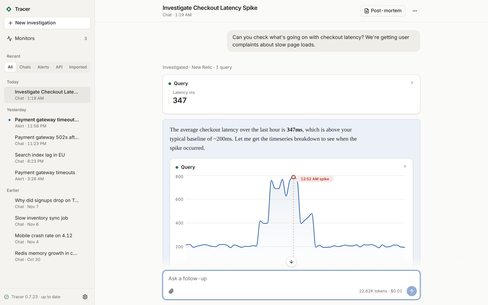
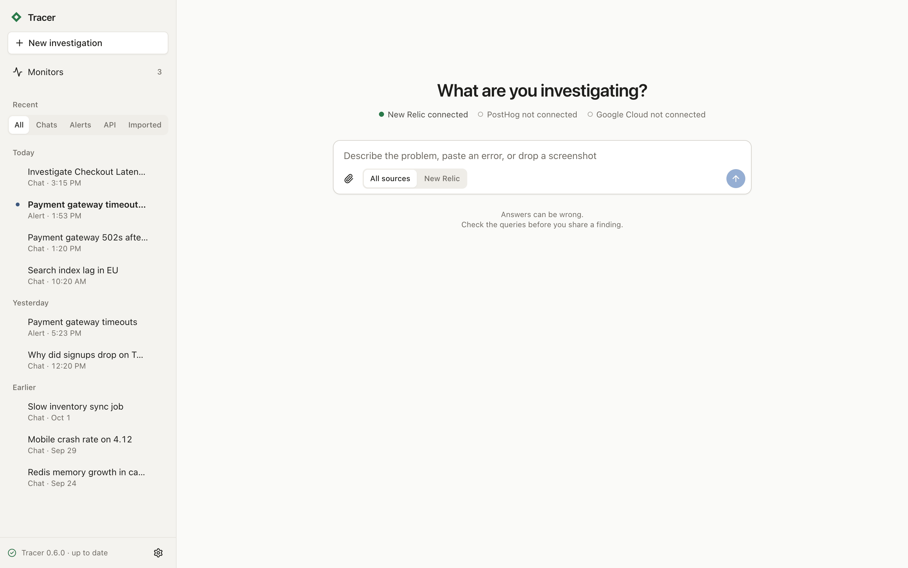
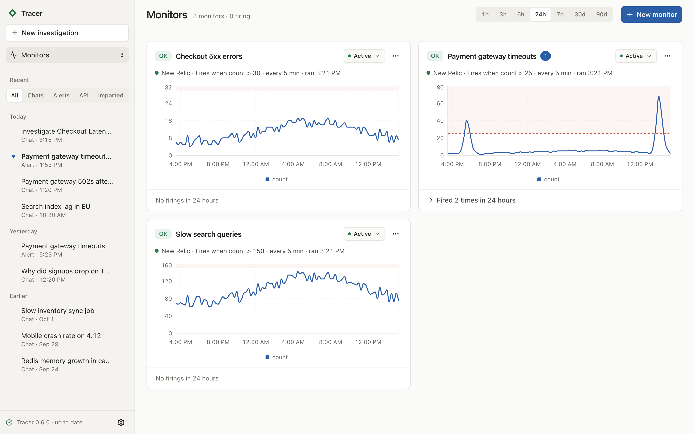
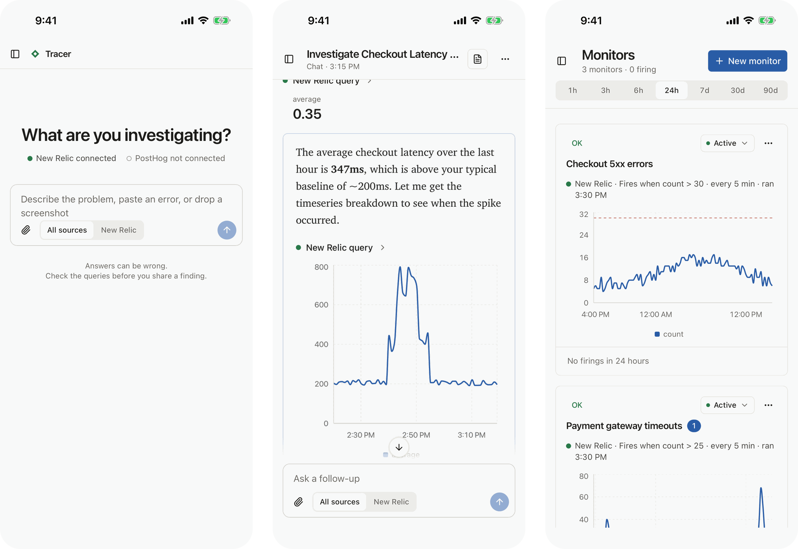

# Tracer

[](https://www.npmjs.com/package/tracer-sh)
[](https://github.com/sholub-dev/tracer/actions/workflows/ci.yml)
[](https://github.com/sholub-dev/tracer/actions/workflows/codeql.yml)

**Ask what broke. Tracer queries your observability tools and finds the root cause.**

Tracer is an AI incident investigator that runs on your machine and on your iPhone.
It uses your own API keys. There is no Tracer server, no account and no telemetry.

[](docs/screenshots/motion-intro.mp4)

## What it does

- **Investigates in chat.** Describe the problem. The agent writes and runs New Relic, PostHog and Google Cloud queries and answers with charts and tables. An investigation ends with a summary card that names the root cause and its evidence. Every query it used stays one click away.
- **Watches for you.** Tell it what to watch. A monitor checks on a schedule, starts an investigation when it fires, and posts the finding to Slack.
- **Goes with you.** The iPhone app runs the full agent on the phone. One QR scan syncs it with your computer.
- **Takes any evidence.** Paste or drop screenshots, logs, code or PDFs into the chat.
- **Shares results.** Export a post-mortem as Markdown.
- **Remembers.** The agent keeps notes across sessions. Each session shows its cost.



## Quick start

Requires [Node.js 22.12+](https://nodejs.org/).

```bash
npx tracer-sh@latest
```

1. Open the link that Tracer prints in the terminal: `Open http://127.0.0.1:3579/#t=...`. The link holds a secret that only your user account can read.
2. In **Settings**, add an LLM key (Anthropic or Google) and connect a data source.
3. Ask a question, for example: *"Why did checkout latency spike after 14:00 UTC?"*

Your browser stores the secret on the first visit. After that, a bookmark of `http://127.0.0.1:3579` works in the same browser. Use the address `127.0.0.1`, not the name `localhost`: the browser stores the secret for the exact address.

To install a fixed version, run `npm install -g tracer-sh`, then `tracer-sh`.
Tracer updates only when you click the version in the sidebar and select **Update now**.



## Monitors



- **Create in chat.** For example: *"Alert me when checkout errors go above 20 in 5 minutes."* The agent tests the query, then saves it.
- **Investigates on its own.** A firing starts a normal investigation. Its result shows in the sidebar under **Alerts**.
- **Skips repeats.** With `FACET`, a group that was investigated in the last 24 hours is marked as a repeat and linked to that session.
- **Posts to Slack.** Add an incoming webhook in **Settings > Integrations**. Tracer posts the severity, the root cause with its confidence label and what it did to the New Relic issue, and tags the people you set.
- **Never misses a window.** Checks run on round clock times over back-to-back windows, so no event counts twice.

## iPhone app



The app runs the whole of Tracer on the phone: the agent, the monitors and the encrypted database.
Calls go straight from the phone to your providers and your LLM.

**Install** (Xcode and a free Apple ID are enough):

```bash
pnpm install
pnpm --filter @tracer-sh/ios build
pnpm --filter @tracer-sh/ios open
```

In Xcode, select your team under **Signing & Capabilities**, select your iPhone, and click **Run**.
A free Apple ID signs the app for 7 days. Requires iOS 15.4 or later.

**Limits on the phone:**
- Monitors check only while the app is open. The screen stays on while an investigation runs.
- Google Cloud, Vertex AI and the CLI are desktop only.

### Sync with your computer

1. On the computer, open **Settings > Phone**. A QR code shows.
2. Scan it with the iPhone Camera, then confirm on the phone.
3. Both devices show a 6-digit code. On the computer, select **Allow** only when the two codes are the same.

The first sync copies everything from the computer, including keys, monitors and sessions. It replaces the phone's data and pairs the two devices.
Later syncs with the same computer merge both ways: the newest version of each item wins, and deletions carry over.
A sync with a different computer replaces the phone's data.
After an update from a version that showed no code, the first sync pairs the devices again, so it also replaces the phone's data.
Each device runs its own monitor checks and handles only its own firings.

The data moves only on your Wi-Fi, encrypted with AES-256-GCM.
The QR code carries a one-time key and the computer's one-time public key. The two devices derive the session key from them; it never travels. Each code works once and expires after 2 minutes.
A merge also needs a secret that both devices stored at their first sync, so a QR code alone never starts one.
Set `TRACER_SYNC=off` on a server that must not sync with a phone.

## Google Cloud

Tracer can run as one always-on container on a small Compute Engine VM, with its keys in Secret Manager.
`scripts/gcp/deploy.sh` asks for your keys, stores them, builds the image and creates the VM.
See [scripts/gcp/README.md](scripts/gcp/README.md).

## CLI

Run an investigation from a script or a coding agent. The server must be running.
The CLI reads the secret of the local server from `~/.tracer/session-token`. For a remote server, set `TRACER_HOST`, `TRACER_PORT` and `TRACER_TOKEN`; the CLI sends the local secret only to a `127.x.x.x` address or `::1`, and it connects to `127.0.0.1` when `TRACER_HOST` is `localhost`.

```bash
tracer-sh analyze "Why did checkout error rate spike after 14:00 UTC?"
```

| Option | Effect |
|---|---|
| `--session <id>` | Continue an earlier investigation with its full context |
| `--provider <name>` | Use one provider only (`newrelic`, `gcp`, `posthog`) |
| `--json` | Print the full result: session id, queries and token usage |

To let Claude Code or Cursor use Tracer, install the Tracer skill from **Settings > Integrations**.

## Providers

| | |
|---|---|
| **Data** | New Relic (NRQL), PostHog (HogQL), Google Cloud (Logs, Traces, Metrics, Errors) |
| **LLM** | Anthropic (Claude), Google (Gemini through AI Studio or Vertex AI) |
| **Jira** | The agent reads issues and comments. Its instructions tell it to post a comment only when you ask. |
| **Slack** | Monitor findings go to one channel through an incoming webhook. |

Each data source setup tests the connection and explains how to create a read-only key.

## Security

- **Local only.** Tracer talks to your providers and your LLM, with your keys. It also asks the npm registry for the newest Tracer version once an hour, and `npx` downloads the Google Cloud MCP package for the Google Cloud data source.
- **Encrypted at rest.** SQLCipher (AES-256) encrypts the whole database. A copied `.db` file is unreadable without the key.
- **Owner-only key file.** Tracer creates a random 256-bit key on first run and writes it to `~/.tracer/db-key` with mode `0600`. On iPhone, the key is in the iOS Keychain.
- **Owner-only files.** The data folder is `0700`.
- **Loopback by default.** The desktop server listens on `127.0.0.1` and rejects requests for any other host name that carry no valid credential. A phone sync opens a short-lived second listener on the Wi-Fi address. `TRACER_HOST` changes the address the server listens on.
- **A secret for every API call.** Tracer creates a random secret on first run and writes it to `~/.tracer/session-token` with mode `0600`. Every API request must carry it. The address of the caller gives no access, so other users and programs on the computer that cannot read the file get no data. The link in the terminal passes the secret to your browser in the URL fragment, which the browser does not send to any server.

Encryption protects the file, not a running session. The key file and the session-token file are owner-only, but code that runs as your OS user reads both files, and with them everything that Tracer reads.
To replace the secret, stop Tracer, delete `~/.tracer/session-token` and start Tracer again. Then open the new link.

**Remote access (token mode).** With `TRACER_HOST=0.0.0.0`, Tracer starts only when `TRACER_TOKEN` is set. Remote clients send `Authorization: Bearer <TRACER_TOKEN>`. In a browser, open `http://<host>:3579/#t=<TRACER_TOKEN>` one time. The token opens every API route except the phone-sync routes. The phone-sync routes accept only the session secret, because they copy every stored key. Tracer does not encrypt the connection, so put a TLS proxy or a private network in front of it.

If you lose `~/.tracer/db-key`, you lose the database. Back up that file if you need a safety net.
To supply the key yourself (CI, a secrets manager), set `TRACER_DB_KEY` to 64 hex characters (`openssl rand -hex 32`).
Connector keys can also come from the environment, for example `TRACER_ANTHROPIC_API_KEY`. A key that is set there replaces the key in **Settings** at each start. See [scripts/gcp/README.md](scripts/gcp/README.md) for the list.

Upgrading from a version that kept the key in the OS keychain: the first start reads the key from the keychain once. macOS asks for access one last time. Choose **Allow**, not **Always Allow**. Tracer then writes the key file and removes the keychain entry. If that removal fails, Tracer prints a notice; remove the entry by hand with `security delete-generic-password -s tracer-sh -a db-key`.

Check it yourself:

```bash
sqlite3 ~/.tracer/data/tracer.db '.tables'    # Error: file is not a database
```

## Troubleshooting

| Problem | Fix |
|---|---|
| Native SQLite build fails | macOS: `xcode-select --install`. Linux: `sudo apt install build-essential python3` |
| Port in use | `TRACER_PORT=3580 tracer-sh` |
| No LLM responses | Add an API key in **Settings** |
| The page says "Open the link that Tracer prints in the terminal" | Open the `Open http://127.0.0.1:3579/#t=...` line from the terminal. Each browser, and each address and port, needs the link one time |
| `tracer-sh analyze` prints `Unauthorized` | Run it as the user that runs the server. If you set `TRACER_HOME` for the server, set it for the CLI too. For a remote server, set `TRACER_TOKEN` |
| Phone does not find the computer | Put both on the same Wi-Fi. Allow **Local Network** for Tracer in iOS Settings |

## Uninstall

```bash
npm uninstall -g tracer-sh
rm -rf ~/.tracer   # settings, sessions and the database key
```

## Contributing

[Open an issue](https://github.com/sholub-dev/tracer/issues) for bugs and ideas.
For code, fork the repo and open a pull request against `master`.

## License

[MIT](LICENSE). Use it, change it and share it, at work or anywhere else.
